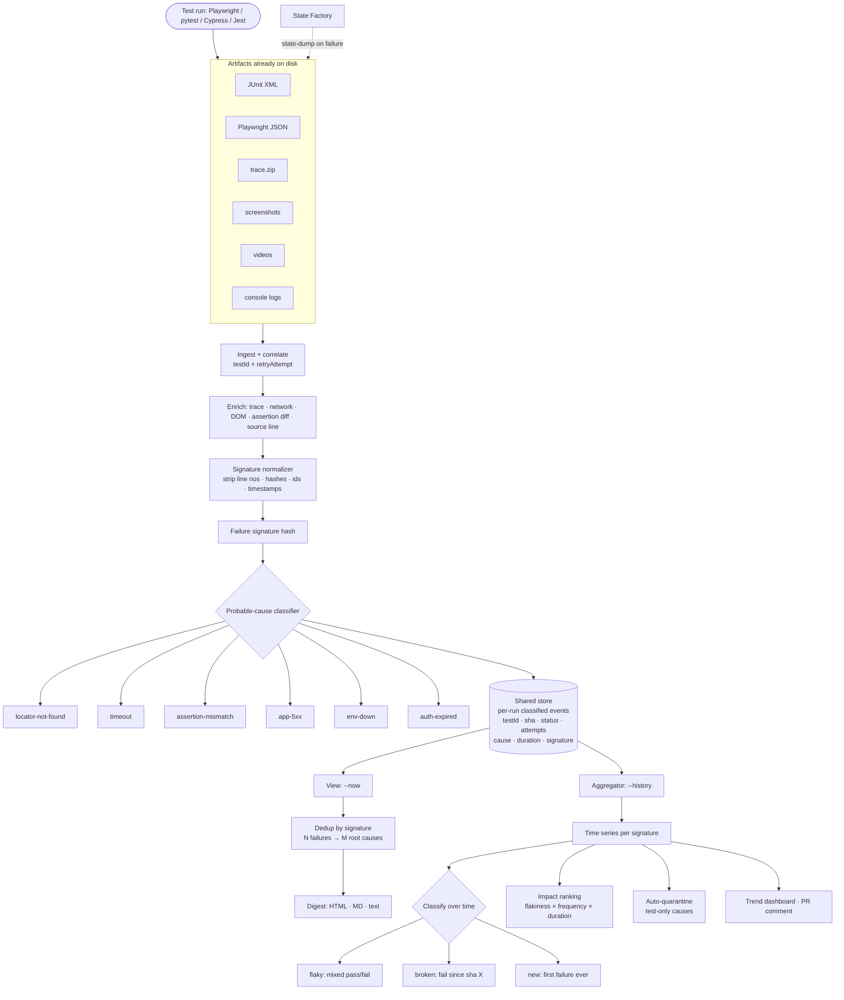
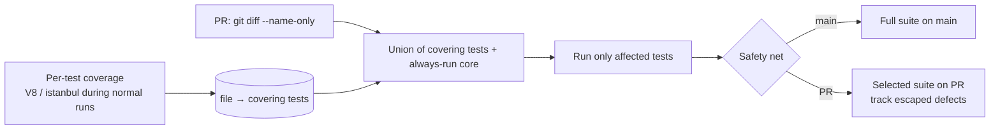

# Failure Digest + Flaky Detector — Integrated QA Execution Tool

One product, two views over a single artifact pipeline:

- **Failure Digest (`--now`)** — per-run: *why did this run fail, right now?*
- **Flaky Detector (`--history`)** — time series: *which tests are unreliable, and how much CI time do they waste?*

They are not two tools bolted together. The Digest is the **event writer**; the flaky detector is the **read model** over those exact events. One parser, one store, one signature normalizer, one binary.

```bash
qa report ./test-results --now       # triage-ready digest of the latest run
qa report ./test-results --history   # flaky trends, impact ranking, quarantine
```

---

## The problem

Two distinct pains, both from the same root cause — fragmented artifacts:

1. **Per-run triage is a click-fest.** Every Playwright/pytest run already writes `test-results/`, traces, screenshots, and JSON. Triaging means opening Trace Viewer 30 times, tabbing between the HTML report, terminal, and app logs. The information exists; it is scattered across five artifacts.
2. **Flakiness is invisible over time.** A test that fails 1-in-5 runs looks fine in any single report. Nobody knows which tests are unreliable, which are genuinely broken, or how much CI time is being burned — until it becomes a crisis.

Solving them separately means parsing JUnit XML twice and normalizing stack traces twice. Solving them together means the Digest's classified output *is* the flaky detector's input.

---

## The insight

Normalize and classify **once**, at ingest. Then:

- Render the latest run as a human-readable digest (the `--now` view).
- Aggregate the same classified events over time (the `--history` view).

The shared **failure signature** is the hinge: both features already need identical normalization (strip line numbers, hashes, GUIDs, timestamps, dynamic IDs). Compute it once → the flaky detector clusters on a *classified cause* instead of a raw stack trace → far higher-quality clustering.

---

## Architecture



---

## Shared foundation (build this first)

| Component | Used by | Notes |
|-----------|---------|-------|
| **Artifact parser** | ingest | JUnit XML primary, Playwright JSON rich; missing files degrade gracefully |
| **Signature normalizer** | digest dedup + flaky clustering | Strip line numbers, hashes, GUIDs, timestamps, numbers → hash |
| **Probable-cause classifier** | digest + flaky causes | Rules first, explainable; model-based fallback later |
| **Correlation key** | both | `{suite, testId, retryAttempt}` — also how retries are detected |
| **Store** | both | SQLite; one event row per test per run |

Nothing downstream re-parses artifacts. The Digest is the producer; the aggregator is a pure consumer.

---

## What the `--now` digest shows

One page per unique root cause (not per failure):

- **Failing step** — action plus file and line
- **Locator + source line** — jump straight to the test code
- **Screenshot at the moment of failure** — not the end-of-test shot
- **Last N network calls** — status, duration, payload snippet
- **Console / page errors** — filtered to the failure window
- **DOM snippet** around the target element
- **Assertion diff** — expected vs actual, highlighted
- **Probable-cause tag** — one of the six classes
- **Retry history** — passed on retry #2 → flaky, not broken
- **Trace deep-link** — opens Trace Viewer at the right action

---

## What the `--history` view shows

- **Flaky / broken / new** classification per test
- **Failure clustering** — 400 failures collapse into ~12 root causes
- **Impact ranking** — *"these 10 tests waste 40 min of CI per day"*
- **Cause-aware flakiness** — *"X is flaky because its locator rots"* vs *"staging 5xx'd"*
- **Environment instability** — many unrelated tests tagged `env-down` in one window → *"your suite isn't flaky, your environment is"*
- **Auto-quarantine** — emit the patch (`test.fixme` / `@Quarantine` / marker) plus a pre-filled ticket

---

## Where the two interlock

- **Digest events populate the flaky store.** No second ingestion path, no duplicate parsing.
- **Cause-aware flakiness is the headline payoff.** Flaky detector alone says "test X is flaky." The Digest says *why*. Together: "X is flaky **because its locator rots**, here's the selector" — which cross-links to Selector Regression CI.
- **Safe auto-quarantine.** Only quarantine genuinely test-side causes (`locator-not-found`, `timeout`, `env-down`). **Never** auto-quarantine `app-5xx` — that is a real bug, and silencing it is how teams ship regressions. The shared classifier is what makes this distinction possible.
- **Separating test flakiness from environment flakiness.** A per-run cause tag repeated across unrelated tests is an environment signal, not a test signal. Only the integrated pipeline can see this.
- **One normalization library, two consumers** — dedup and clustering stay consistent by construction.

---

## Classification

**Over a single run (digest):**

| Cause | Rule |
|-------|------|
| `locator-not-found` | "locator not found" / element resolution error |
| `timeout` | `Timeout` / `waitFor` exceeded |
| `assertion-mismatch` | `expect(...)` with expected/actual present |
| `app-5xx` | any `5xx` in the failure window |
| `env-down` | `ECONNREFUSED` / DNS failure / connection reset |
| `auth-expired` | `401` / `403` / redirect to login |

Rules first — they are explainable and cover most cases. Model fallback only where rules are ambiguous.

**Over time (flaky):**

- **flaky** = mixed pass/fail on the same commit or within a short window
- **broken** = consistently failing since a specific sha → bisect to the culprit commit
- **new** = first failure ever → triage now

---

## CLI

```bash
# Digest the latest run
qa report ./test-results --now --format html,md,text --dedupe

# CI: post digest as a PR comment, strict on non-flaky failures
qa report ./test-results --now --format md --comment --strict

# History: flaky trends and impact
qa report ./test-results --history --window 14d --dashboard

# Auto-quarantine test-side causes only, never app-5xx
qa report ./test-results --history --quarantine --exclude-cause app-5xx
```

---

## Technical details

- **Inputs**: JUnit XML (universal), Playwright JSON (rich). Cypress/Jest JSON optional. Traces, screenshots, and videos are enrichments — absent artifacts degrade gracefully.
- **Trace parsing**: Playwright `trace.zip` contains `trace.trace`, `trace.network`, and resources. Parse actions/network/console directly; never require Trace Viewer to be open.
- **Signature normalization**: strip line numbers, hashes, GUIDs, timestamps, dynamic IDs, and numeric literals, then hash. Same library for digest dedup and history clustering.
- **Store schema**: `events(run_id, sha, branch, suite, test_id, attempt, status, cause, duration_ms, signature, machine, ts)` in SQLite. Cheap to host, trivial to self-host.
- **Impact ranking**: `flakiness_rate × run_frequency × duration`.
- **Determinism**: seeded RNG where any data is generated so failures reproduce.
- **Rendering**: single self-contained HTML (inline CSS, base64 images) for offline/ticket attachment; markdown for PR comments; `json` for piping into other dashboards.
- **Distribution**: `npx qa-report`, a GitHub Action, plus a Playwright reporter wrapper that runs the digest automatically on failure.
- **Risks**: trace format version drift → pin Playwright versions, fail soft; huge artifacts → cap embedded media by size and lazy-link the rest; DB driver-style schema coupling does not apply here since the store is self-owned.

---

## Bonus: Test Impact Analysis (phase 3)

Once the store exists, impact analysis is a cheap add-on — the same events plus per-test coverage:



The safety net is mandatory: full suite on `main`, selected suite on PRs, and track "escaped defects" to prove the selection isn't lying.

---

## Why this is useful daily

- **Removes the triage click-fest** — the single biggest time sink in a QA day.
- **Dedup is the multiplier** — 40 failures with 6 root causes become 6 pages, not 40.
- **Flaky vs broken, instantly** — retry history separates "passed on retry" from "dead since this commit."
- **One install covers every stack** — JUnit XML is the lingua franca across Playwright, pytest, Jest, JUnit, TestNG, Robot, Cypress.
- **Turns noise into root causes** via clustering and cause tags.
- **Cuts CI cost** with impact analysis (phase 3).
- **Sticky by design** — a year of history means leaving costs you your flaky baseline.

---

## Build order

1. **Digest (`--now`)** — smallest, standalone, useful from a single run. Needs only the parser, normalizer, classifier, and renderer.
2. **Flaky aggregator (`--history`)** — pure consumer of step 1's events. Almost no new parsing.
3. **Test Impact Analysis** — coverage mapping + PR selection on top of the same store.

Integration is the default, not a later merge — the shared store and signature are what make both views cheap.
